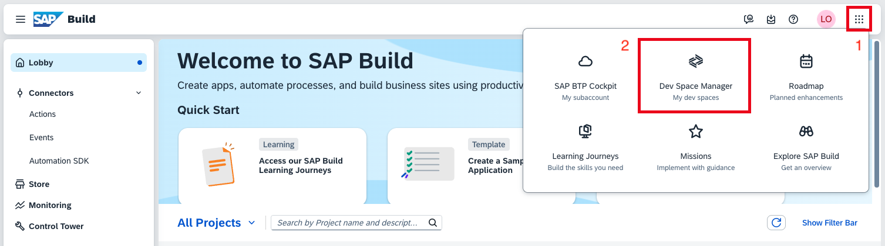
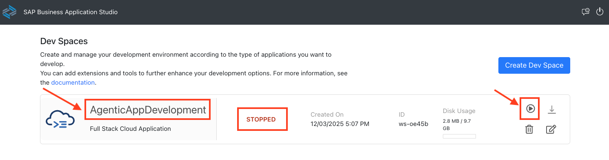
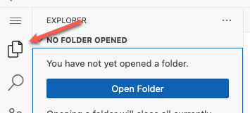
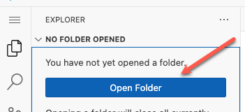
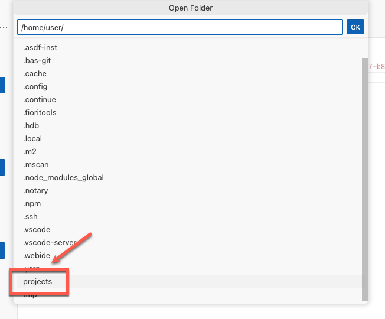
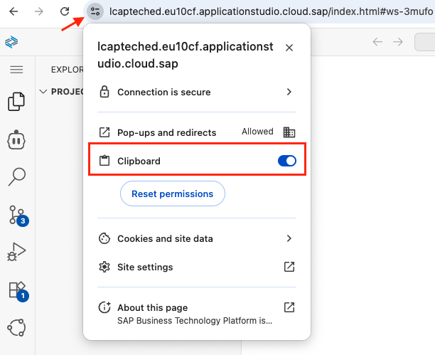
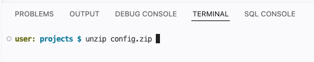

# Exercise 1.0 - Set up your AI development environment

**Part 1 - Build a custom SAP Fiori app**

In this exercise you set up your development environment in SAP Business Application Studio and configure its AI Chat, so you are ready to generate your first SAP Fiori app with AI tooling in the next exercise.

As a participant of this hands-on session, you should already be set up with access to the SAP Business Application Studio landscape used below as your development environment.

## Access SAP Business Application Studio

1. Open https://lcapteched.eu10.build.cloud.sap/lobby in a new browser window or tab, which will ask you to login.

2. Enter the credentials in the browser window or tab to complete your login.

    

## Access the Dev Space Manager

1. On the SAP Build landing page, click the **Switch Product** button in the top right corner and select **Dev Space Manager**.

    

## Open the development space

1. Make sure that the development space **AgenticAppDevelopment** has the status running. If stopped, click the **start** button.

    

2. Once running, click the development space name to open it. This can take some time.

    

3. Click **OK** in the popup window to accept the tracking settings in the newly created dev space.

    

## Open your project folder

1. Select the **explorer icon** on the left side.

    

2. Select **Open Folder**.

    

3. Select the **projects** folder from the drop down.

    

4. Click **OK** and your window will reload.

    

5. Enable **Clipboard access** for the instance in the Chrome browser.

    

6. Download **[config.zip](../../../config.zip)** to your local machine, then drag and drop it into the projects folder in SAP Business Application Studio.

7. Open a terminal and run the following command to extract:

    ```bash
    unzip config.zip
    ```

    

8. Ensure that the projects folder has the following content.

    

## Configure AI Chat (AI client)

SAP Business Application Studio provides [AI Chat](https://help.sap.com/docs/bas/sap-business-application-studio/ai-chat) (powered by GitHub Copilot) as your AI coding assistant. You will use it throughout the exercises.

1. Open **AI Chat**.

    

2. Select the model **Claude 4.7 Opus (SAP Build)**.

    

## Summary

You have successfully set up your AI development environment with SAP Business Application Studio and configured its AI Chat.

Continue to - [Exercise 1.1 - Create a CAP project and SAP Fiori app from an image](../ex1.1/README.md)
