# Exercise 2 – Build an Agent with Joule Studio

Switch from *designing views* to *building an agent*. In this exercise you use
**SAP Joule Studio** to create a small AI agent that reads **travels** from the
SAP **SFlight** demo scenario — retrieving them by customer, by agency, and
drilling into the details of a single travel — all from one plain-language
description.

> **Dataset:** the standard SAP **SFlight** travel scenario — travels, bookings,
> agencies, customers, prices, status. SFlight ships for both **RAP** (ABAP) and
> **CAP** (Node.js/Java), so the same scenario is reachable whichever stack your
> landscape uses.
> **Format:** work through each step at the screen as you read.
> **Reference:** <https://www.sap.com/products/artificial-intelligence/joule-studio.html>

Steps:

- [2.1 Sign in](#21-sign-in)
- [2.2 Open Joule Studio](#22-open-joule-studio)
- [2.3 Create a new Agent solution](#23-create-a-new-agent-solution)
- [2.4 Describe the agent and start building](#24-describe-the-agent-and-start-building)
- [2.5 Joule Studio generates the intent](#25-joule-studio-generates-the-intent)
- [2.6 Answer the one required business goal](#26-answer-the-one-required-business-goal)
- [2.7 Review the generated intent document](#27-review-the-generated-intent-document)
- [2.8 Generation completes](#28-generation-completes)
- [2.9 Review the test results](#29-review-the-test-results)
- [2.10 Open the mock-data preview](#210-open-the-mock-data-preview)
- [2.11 Ask the agent for travels](#211-ask-the-agent-for-travels)
- [2.12 Read the answer and the trace](#212-read-the-answer-and-the-trace)
- [2.13 Explore the generated artifacts](#213-explore-the-generated-artifacts)

## What is Joule Studio?

**Joule** is SAP's generative-AI copilot, woven across the SAP portfolio. It no
longer only *answers* questions — it increasingly *acts*, carrying out
multi-step tasks on your business data and processes.

**Joule Studio** is where those acting capabilities are built. Think of it as
the **design-time workbench for AI agents** — a low-code environment, part of
SAP Build on SAP BTP, for **creating, testing, deploying, and orchestrating**
the agents that then come to life inside Joule. It turns "I wish Joule could do
X with our data" into a working, governed agent — without starting from a blank
code file.

**What makes it compelling:**

- **From intent to agent.** You describe a business challenge in plain language;
  Joule Studio drafts the agent for you — its intent, requirements,
  specifications, and the generated solution artifacts (including the service
  and backend code). You stay in control and refine, rather than wire everything
  by hand.
- **Grounded in real SAP data.** Agents reach business data through **skills**
  and **actions / tools** — an OData service, an API, or a RAP/CAP business
  service — so answers are based on actual records, not guesses. In this
  exercise the agent is grounded in the SFlight travel data.
- **Reasons across steps.** An agent is given a **purpose** and **instructions**
  and can plan a multi-step approach — deciding *which* skill to call for a
  given request — instead of following one fixed script.
- **Safe to try before you ship.** Built-in **testing** and a **mock-data
  preview** let you see exactly how the agent behaves before it is deployed,
  with full **traces** of each run for transparency.
- **Orchestrated and reusable.** Joule routes each user request to the right
  agent (and each agent to the right skill), so specialised agents compose into
  one assistant and can be reused across business scenarios.

**The connection to this session.** One business scenario (SFlight) runs through
all three parts. In **Part 1** you built a custom SAP Fiori app and the **OData
service** beneath it — the data, and one fixed way of showing it. **Here in
Part 2** you build a complementary agent that *retrieves and reasons over* that data: an
agent that answers plain-language questions instead of rendering a fixed screen.
In **Part 3** (the Compositional Design System)
the system decides *how* to present it in Joule Work.

> **The goal of this exercise.** Create a demo agent whose purpose is to
> **retrieve travels** from SFlight — by customer, by agency, and so on — and to
> **show the details of a specific travel**. You describe that intent once, let
> Joule Studio build the agent end to end, then test it against mock data.

> **Where this is heading.** The full-stack vision is a single end-to-end loop:
> the **custom OData service** behind the SAP Fiori app from the earlier
> exercise becomes the very data source your agent reasons over — your own app,
> your own service, your own agent, surfaced in Joule. Binding a Joule Studio
> agent *directly* to that custom OData service is on the roadmap and not yet
> available, so in this exercise Joule Studio provisions an equivalent **SFlight
> backend** for the agent instead. That lets you walk the complete flow exactly
> as it is designed to work today — only the final hop to your own service is
> still to come. Everything you do here maps one-to-one onto that end state.

## 2.1 Sign in

Open **SAP Joule Studio**: <https://747391938.eu10.sapdas.cloud.sap/new/>

On the **Log On** screen, sign in with the credentials assigned to your number, from [the credentials repository](https://github.com/Sebastianwerner1985/163/blob/main/JouleStudio.md):

1. Enter your **Email or User Name** (1).
2. Enter your **Password** (2).
3. Click **Log On** (3).

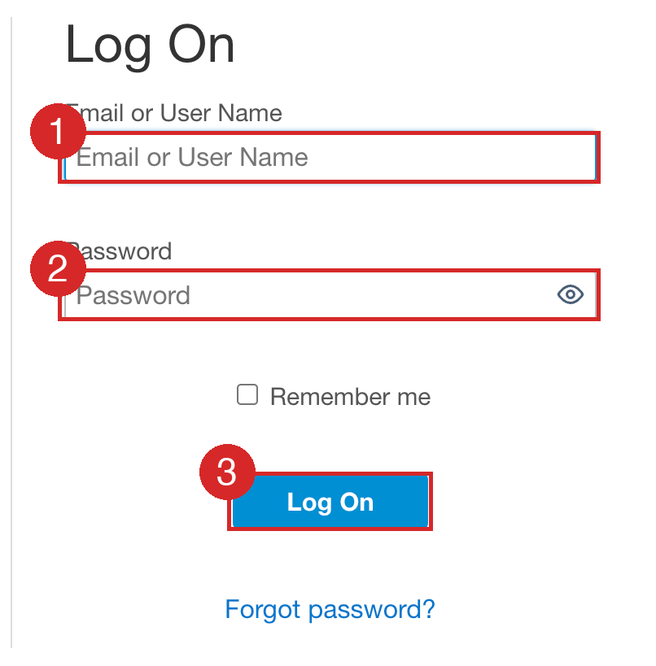

## 2.2 Open Joule Studio

From the Joule Work home, open the **Joule Studio** entry point (bottom-left).
This switches from *chatting with* Joule to *building for* it.

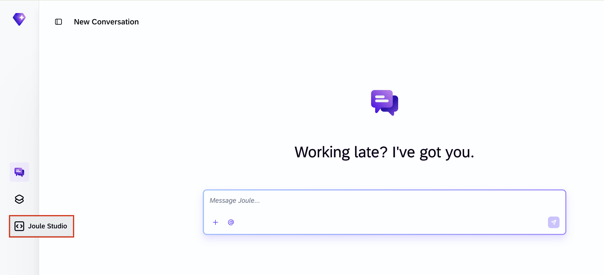

## 2.3 Create a new Agent solution

On the **Create a new solution** page, Joule Studio offers several solution
types. Under **Agent** — *"Create, test, and deploy custom Joule agents tailored
to your SAP landscape and business processes"* — click **Create**.

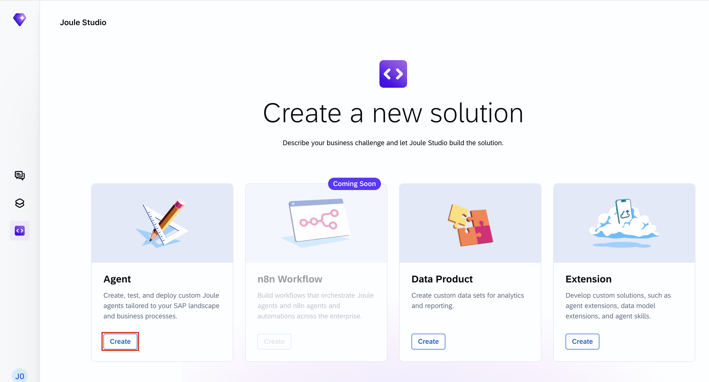

## 2.4 Describe the agent and start building

The **Create Agent** dialog opens. Fill it in using the marked areas:

1. **Name** (1). Enter `SFlight Agent`.
2. **Intent Statement** (2). Paste the brief below. It names the scenario, the
  data source, and the purpose, and explicitly tells the builder not to pause
  for clarification:

    ```
    Please create an agent. The agent should be based on SAPs SFlight demo scenario which is available for RAP and CAP. The purpose is to create a demo agent to retrieve travels, e.g. by customer, by agency, etc. and see the details of a specific travel. Please skip clarifying questions and proceed to the agent creation.
    ```

3. **Quick Create** (3). Leave **Quick Create** ticked — *"Skip clarifying
  questions and start directly building the solution"* — so the builder goes
  straight to work.
4. **Create** (4). Click **Create** to start.

Leave **Solution** on **New Solution**. Everything the agent is built to do
traces back to this one description.

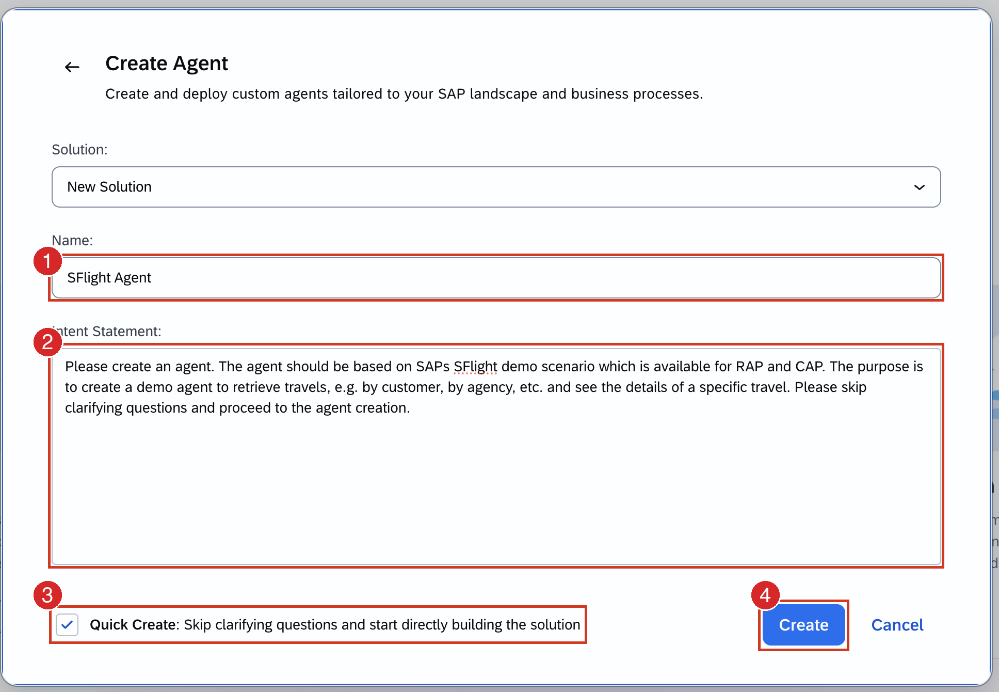

## 2.5 Joule Studio generates the intent

Joule Studio opens the **Develop** workspace and begins with **Generating
Intent**. On the left, **Solution Progress** lists the stages it works through —
**Intent Summary → Requirements → Specifications → Solution Artifacts**. On the
right, the assistant panel streams its reasoning: thoughts, activated skills,
and the tools it calls.

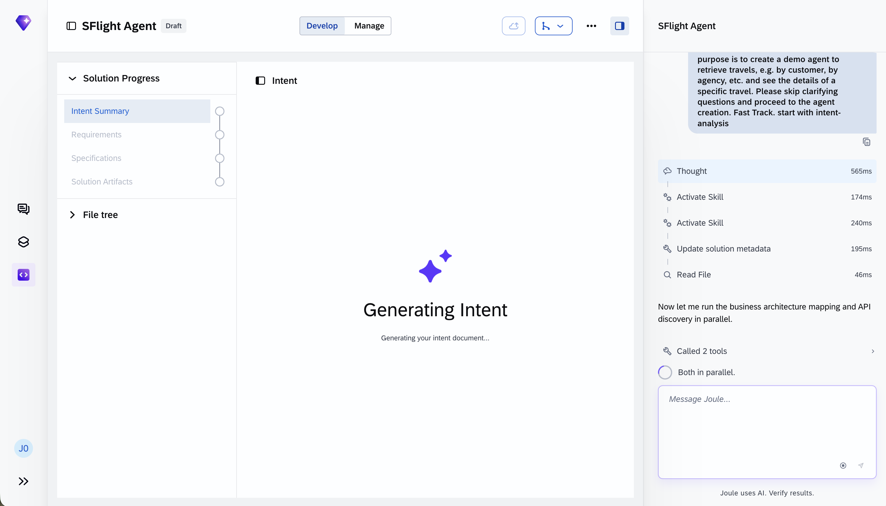

## 2.6 Answer the one required business goal

Even in fast-track (**Quick Create**) mode, the builder may ask a few
clarifying questions to tailor the agent more closely to your needs. The
question you see may look like the screenshot below, or differ slightly.

1. **Select the options that fit** — in this screenshot, for example,
  demonstrating natural-language travel queries, reducing the time to retrieve
  travel information, and enabling non-technical users to explore SFlight data.
2. **Submit Answer** to continue.

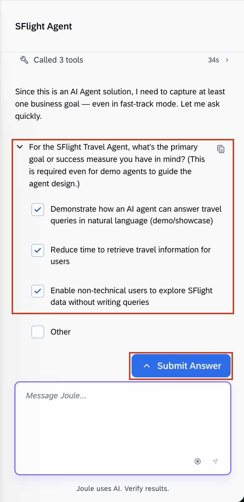

## 2.7 Review the generated intent document

Joule Studio produces an **Intent** document for the **SFlight Travel Agent** —
a *Business challenge*, *Business Goals & Success Criteria*, and more. In
**Solution Progress** the completed stages now show green checkmarks. From here
the builder continues on its own into requirements, specifications, and building
the artifacts (including the CAP SFlight backend).

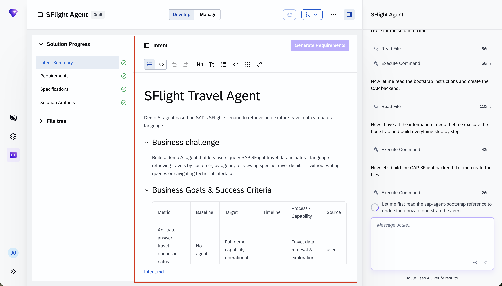

> **This part takes a while.** After the intent is approved, Joule Studio builds
> the whole agent end to end — generating requirements, specifications, the
> service definition, and the CAP backend, then running its checks. Expect this
> to run for **several minutes**.
> Let it work; you don't need to intervene while it builds.

## 2.8 Generation completes

When the build finishes, every **Solution Progress** stage is complete and
**Solution Artifacts** lists what was produced — the `sflight-travel-agent` and
the `customer-build-sflight-travel-service` artifacts among them.

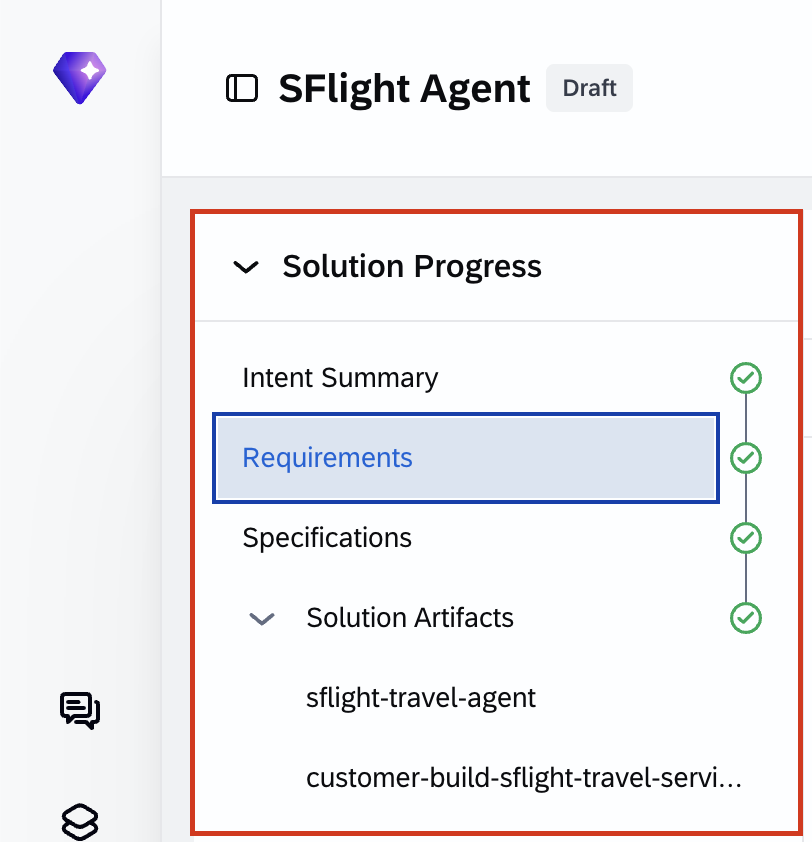

## 2.9 Review the test results

Open **Testing → Overview**. Joule Studio generated and ran an automated test
suite for the agent. In this capture: **126 Total Tests**, **126 Passed**,
**0 Failed**, **100% Score**. The number of tests may vary. You can re-run them any time with **Test
Solution**.

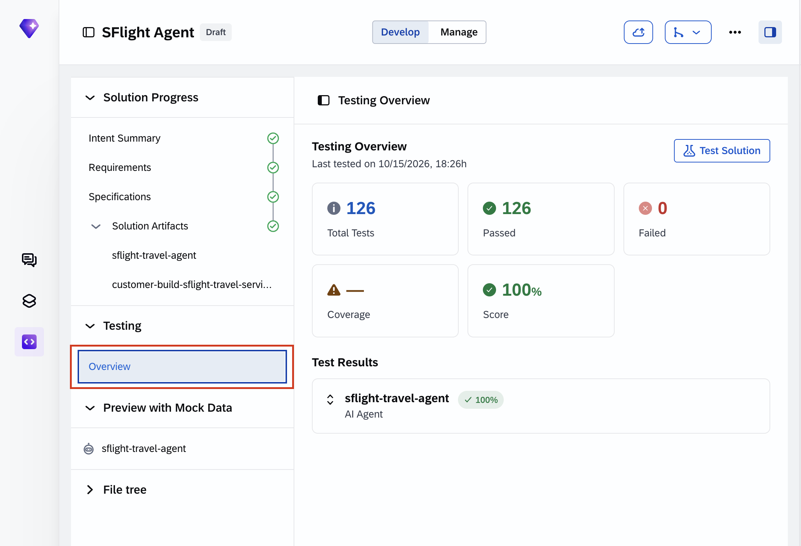

## 2.10 Open the mock-data preview

Under **Preview with Mock Data**, select **sflight-travel-agent**. This opens
**Preview Your Agent with Mock Data** — a chat where you can try the agent
before deployment. The banner notes the agent is **connected to mock data**, so
responses are representative rather than live.

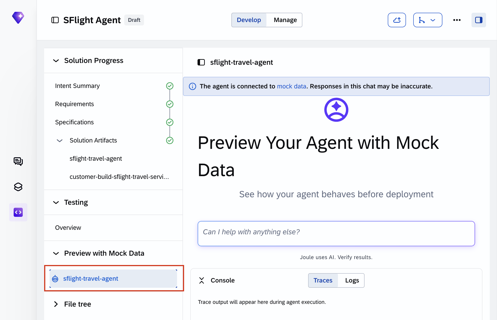

## 2.11 Ask the agent for travels

In the preview chat box, type a natural-language request and send it:

```
Show me open travels
```

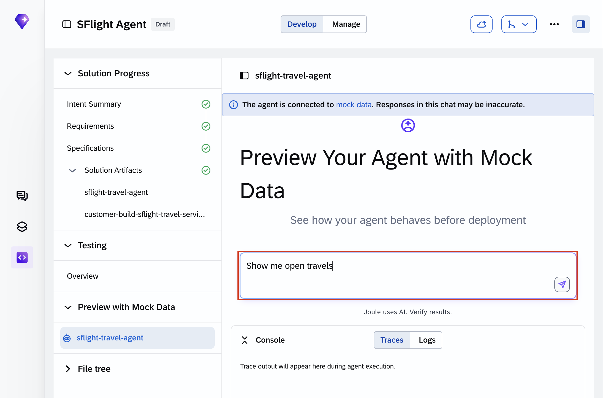

## 2.12 Read the answer and the trace

The agent retrieves the matching travel and renders its details — here
**Travel ID: 1** with **Status**, **Customer** (Theresia Buchholm), **Agency**
(Fly-Away), **Description**, **Travel Dates**, **Total Price**, and **Booking
Fee** — and even notes a related travel you could look at next. Below, the
**Console → Traces** panel shows the **Agent Run** and the tools it invoked, so
you can see *how* the answer was produced.

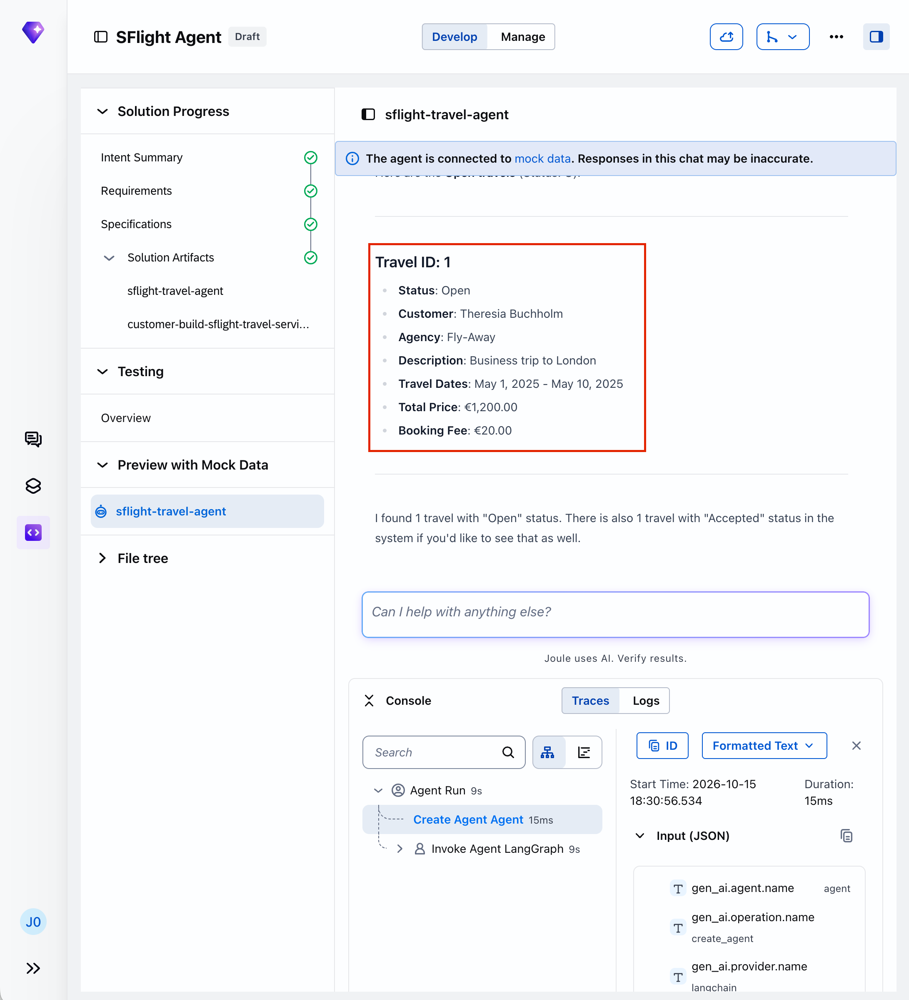

This is the agent fulfilling its purpose: retrieving travels and showing the
details of a specific one, in plain language, grounded in the SFlight data.

## 2.13 Explore the generated artifacts

Expand the **File tree** to see what Joule Studio actually built. Alongside the
agent app (`sflight-travel-agent/app` with `main.py`, `agent.py`,
`agent_executor.py` etc., skill resources, and tests) sits the **CAP backend**
(`sflight-cap-backend`) and the `travel-service.cds` service definition. The
agent is real, inspectable code — not a black box.

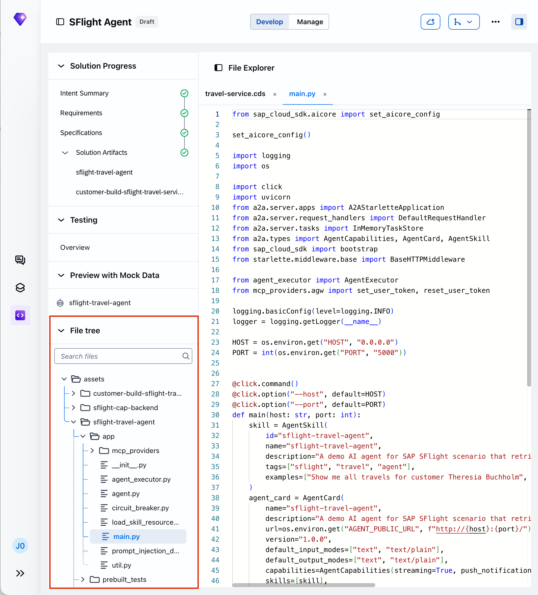

## Summary

- **Joule Studio** is the low-code workbench for building, testing, and
  orchestrating the AI **agents** that run inside **Joule**.
- From a single plain-language brief, it generated an agent end to end —
  intent, requirements, specifications, a tested **CAP backend**, and the agent
  app — grounded in the **SFlight** travel data.
- The agent does its work through **skills / actions** and **reasons across
  steps**; you watched it **retrieve travels** and **show the details of one
  travel** in the mock-data preview, with full **traces**.
- Same business scenario throughout the session: in **Part 1** you built the
  app and its OData service and shaped *how* data is shown in SAP Fiori, in **Part 3** the
  Compositional Design System decides *how* to present it in Joule Work, and here in **Part 2**
  you built **what retrieves and reasons over** it.

---

This completes Part 2.

Continue to - [Exercise 3.0 - Getting Started: Compositional Design System](../ex3/3.0-getting-started/README.md)
