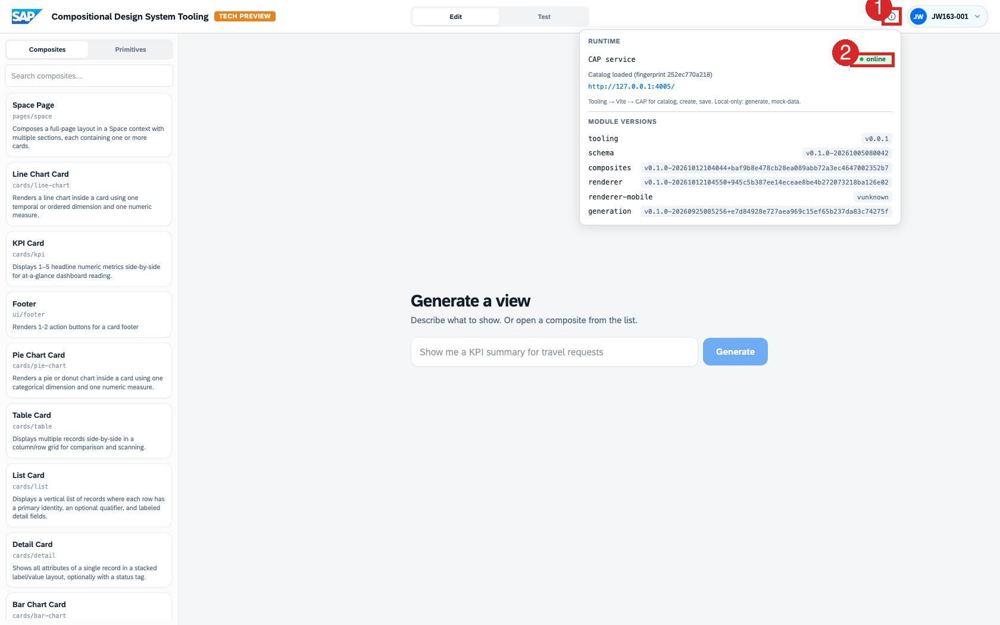
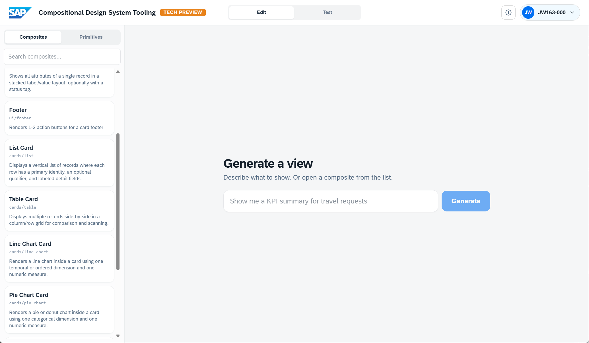

# Exercise 3.0 – Getting Started: Compositional Design System

You've built a custom SAP Fiori app with AI tooling (Part 1) and seen an agent reuse service metadata to surface business data (Part 2). **Part 3 looks behind the curtain.** Here you focus on the *how*, namely how the **SAP Compositional Design System** assembles enterprise UI from your intent and data *at runtime*, selecting from a pre-defined catalog of building blocks.

In this exercise you use a Tech Preview of the **SAP Compositional Design System tool** to explore these features hands-on.

This page gets you into the tool and oriented, then three short exercises walk you through how it works. Read on: everything you need before you start is below.

Steps:

- [3.0.1 Sign in](#301-sign-in)
- [3.0.2 The dataset](#302-the-dataset)
- [3.0.3 Check your setup](#303-check-your-setup)
- [3.0.4 Find your way around the screen](#304-find-your-way-around-the-screen)

## 3.0.1 Sign in

Open the **SAP Compositional Design System tool (Tech Preview)**: <https://compositional-ui-tooling.cfapps.eu10-005.hana.ondemand.com/>

On the login screen, choose **`tdct3ched1.accounts.ondemand.com`** as the identity provider.

Use the login credentials assigned to your number, from [the credentials repository](https://github.com/Sebastianwerner1985/163/blob/main/CompUI.md).

> **Note:** The tool is a Tech Preview, so it is still rough in places and not everything is
> finished. Some things may not work as expected, and a re-run often resolves it. That is fine here:
> the goal is to get a feel for how it works, so explore freely and do not worry if you hit a rough
> edge.

## 3.0.2 The dataset

A set of **mock data** modeled on the standard SAP **SFlight** travel scenario: travels,
bookings, agencies, customers, prices (USD), booking fees, status (Open / Accepted / Canceled),
and start/end dates. It is sample data for this test drive, not a live service. Composite previews
and generated views use this mock data.

## 3.0.3 Check your setup

Click the **ⓘ** button in the top-right (1). The popover should show **CAP service · online** (green) (2), confirming the SAP Compositional Design System service is reachable. If it's offline, flag it before starting.

## 3.0.4 Find your way around the screen

The tool has two workspaces, switched from the **Edit / Test** tabs in the top bar:

- **Test**: where you generate a view from a prompt and read how the system arrived at it.
- **Edit**: where primitives and composites, and their rules, are authored and inspected.

The main elements:

1. **Generate a view** (center). A prompt box for what you want to show, with a **Generate** button. This is the starting point in **Test**.
2. **Catalog** (in **Edit**). The **Composites / Primitives** tabs choose which building blocks appear in the library; you open and inspect them here.
3. **Top bar.** The **SAP logo** returns home, **Edit / Test** switches workspaces, and the **ⓘ** button reports the service connection (CAP service · online).

Everything the system can build from lives in the Catalog. It does not invent components; it composes only what has been approved. You explore what is in the Catalog, and how it is used, in the exercises.

Ready? Continue to - **[Exercise 3.1 – Understand the Concepts](../3.1-concepts/README.md)**.
