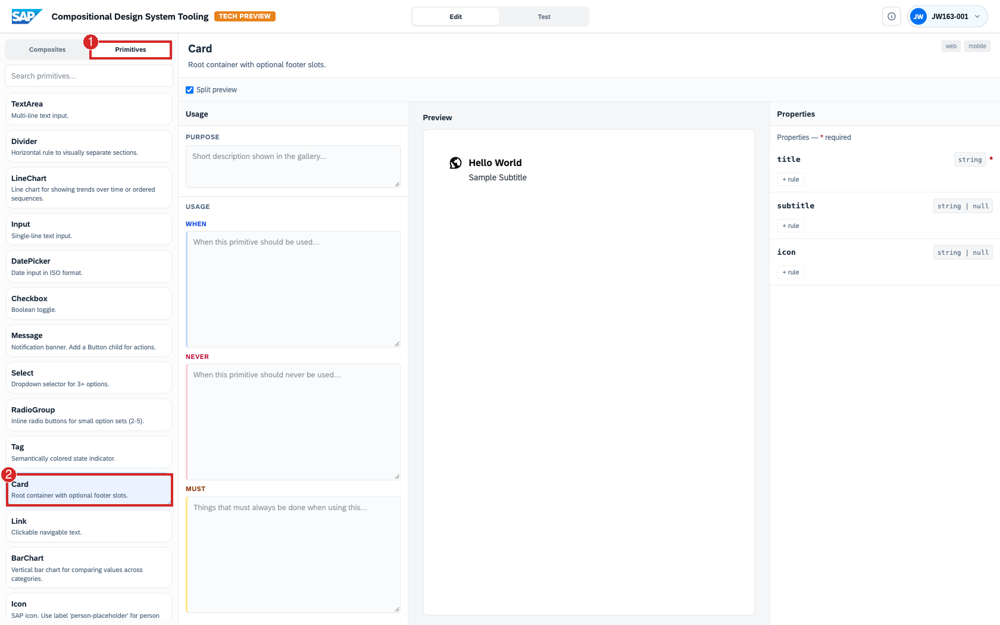
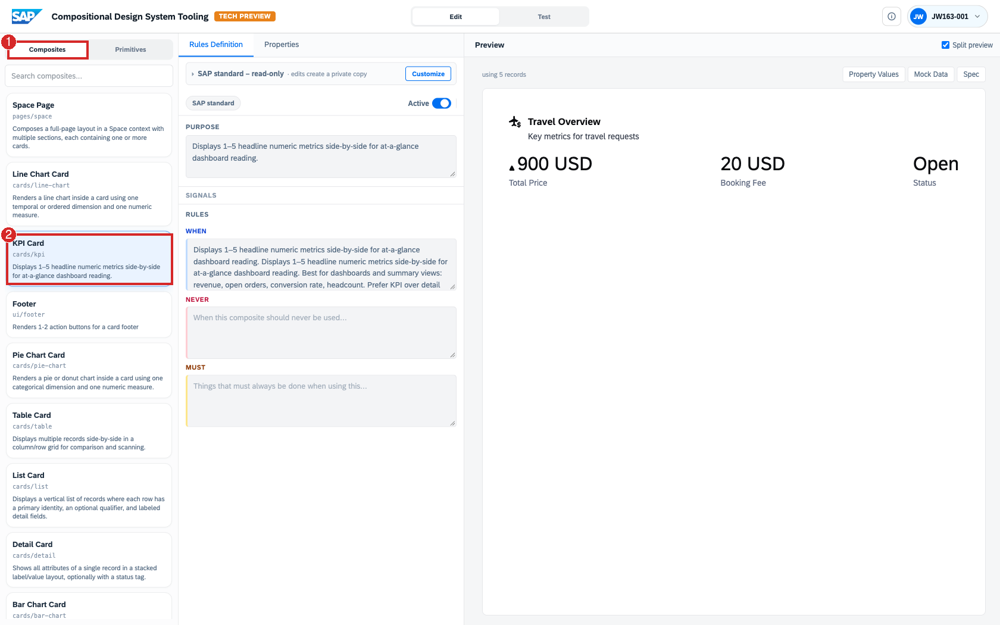
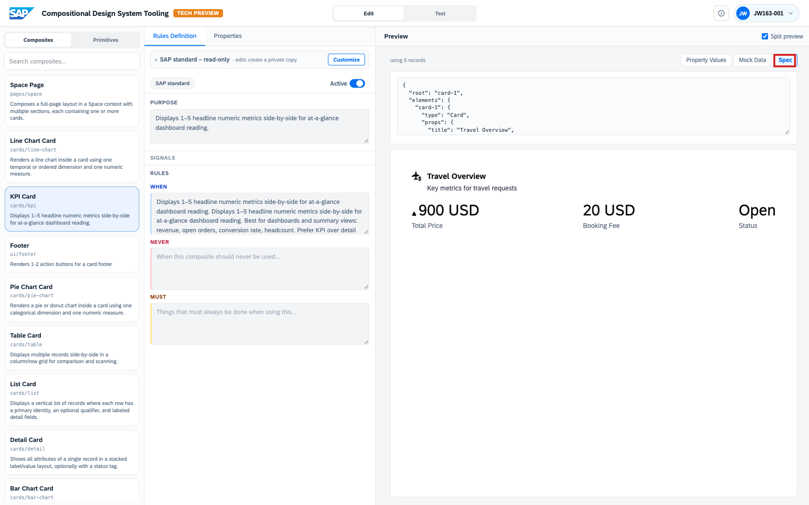

# Exercise 3.1 – Understand the Concepts

This exercise introduces the ideas the rest of the session rests on. You look at each one in the
tool, but the goal here is understanding, not clicking through a task: **primitives**, **composites**
(and the **design knowledge** that ships with them), and the single **spec** they all reduce to.

> **Tool:** <https://compositional-ui-tooling.cfapps.eu10-005.hana.ondemand.com/>
> **Dataset:** mock data for the SAP **SFlight** travel scenario (travels, bookings, agencies, prices, status).

Steps:

- [3.1.1 Primitives — the fixed vocabulary](#311-primitives--the-fixed-vocabulary)
- [3.1.2 Composites — extensible building blocks with design knowledge](#312-composites--extensible-building-blocks-with-design-knowledge)
- [3.1.3 The spec — one artifact, many surfaces](#313-the-spec--one-artifact-many-surfaces)

## The core principle

You describe *what* you want to see; the system determines *how* to present it, by selecting a
pre-approved building block (a composite), filling it with the data, and rendering it. The result
stays on-brand because every building block ships with the rules that govern its use. Keep this
*what vs. how* distinction in mind: the whole session is a sustained demonstration of it.

Everything the system can build from lives in the **Catalog** (in the **Edit** workspace), in two
tabs: **Primitives** and **Composites**. The system does not invent components; it composes only
what is in the Catalog.

## 3.1.1 Primitives — the fixed vocabulary

Open **Edit → Catalog → Primitives** and select **`Card`**.

Primitives are the smallest atomic building blocks, a `Card`, a `Table`, a `Metric`, a `BarChart`,
a `Button`, a `Tag`, and so on (around 25 of them). They ship as code and the system cannot alter
or decompose them. They are the fixed vocabulary, deliberately few and tightly described: each has
a short, single-purpose definition and strongly typed properties (for `Card`, `title` is a required
`string`; `subtitle` and `icon` are optional). That precision is what lets the system choose between
them reliably.



## 3.1.2 Composites — extensible building blocks with design knowledge

Switch to the **Composites** tab and open **`KPI Card`** (`cards/kpi`).

Composites are built from primitives (and other composites) and expressed as a spec, not code, so
the catalog is extensible: it can grow without a code release.

What makes a composite more than a layout is the **design knowledge** attached directly to it (not
kept in a separate document). It is the project's design knowledge, expressed as **rules**, and the
system reads it as selection criteria:

- **Purpose** and **Signals** describe what the composite is for and give the system hints to match
  a request to it. The KPI card is for one to five headline numeric metrics.
- **When / Never / Must** position it precisely: *when* it should be used, *never* — when it must
  not be, and *must* — what always has to hold when it is. For the KPI card this means dashboard
  summaries, a numeric snapshot rather than a table of individual records.



These rules travel *with* the composite into the system's reasoning. The system does not guess at
good design; it is given the design knowledge and constrained by it. This is what drives selection
later: a *KPI summary* request lands on the KPI card, a *table* request on a table, and the
**Reasoning flow** explains why. The preview is already bound to the SFlight mock data, so it is a
live view, not a static illustration.

## 3.1.3 The spec — one artifact, many surfaces

With **`KPI Card`** open, switch the preview to **Spec**.

The spec is a single declarative JSON document. It references primitives by `type`, carries the data
bindings, and is the one hand-off artifact a renderer turns into UI:

```json
{
  "root": "card-1",
  "elements": {
    "card-1": {
      "type": "Card",
      "props": { "title": "Travel Overview" }
    }
  }
}
```



The same spec format is used whether a composite is hand-built or system-generated, and the same
spec can render to web, mobile, or other surfaces. One spec, many surfaces: this is the *how* made
concrete.

## Summary

The concepts the rest of the session builds on:

- **Primitives** — the fixed, atomic, code vocabulary.
- **Composites** — extensible building blocks expressed as a spec, not code, each carrying its own
  **design knowledge** (the When / Never / Must rules that drive selection).
- **The spec** — the single JSON artifact a renderer turns into UI.

Continue to - **[Exercise 3.2 – Author and Generate](../3.2-author/README.md)**, where you make the system generate views and author a new composite of your own.
