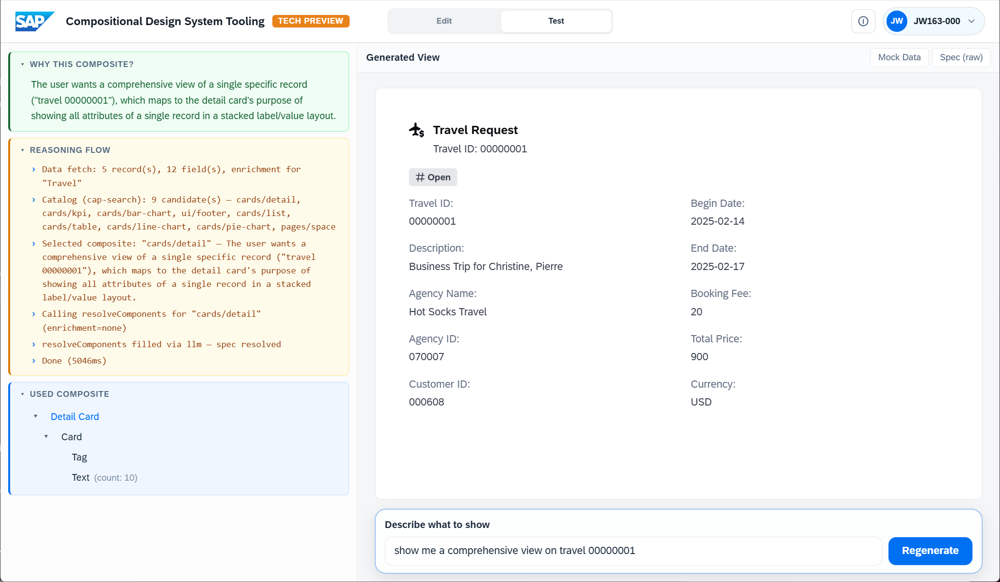
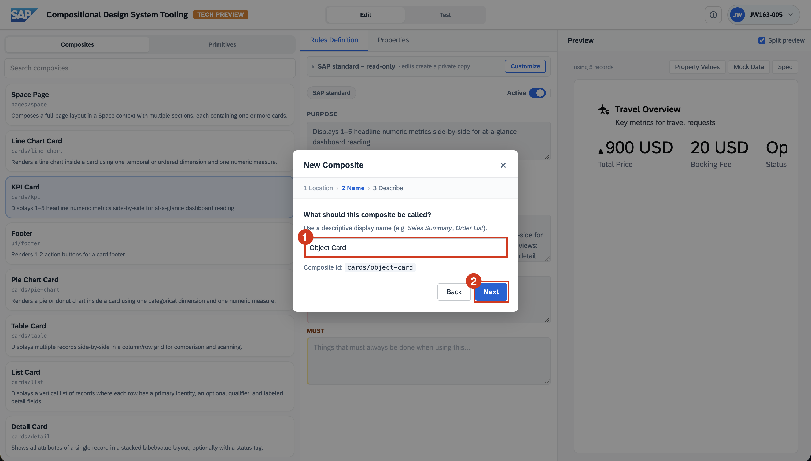
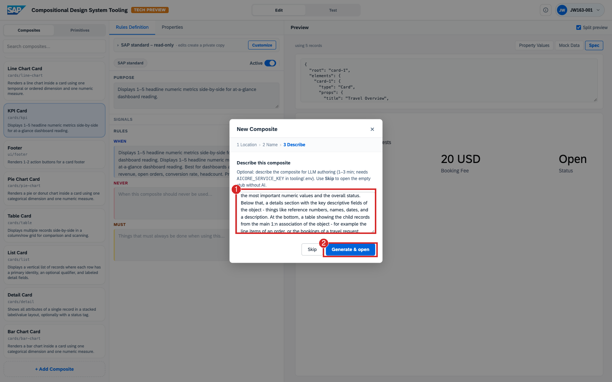
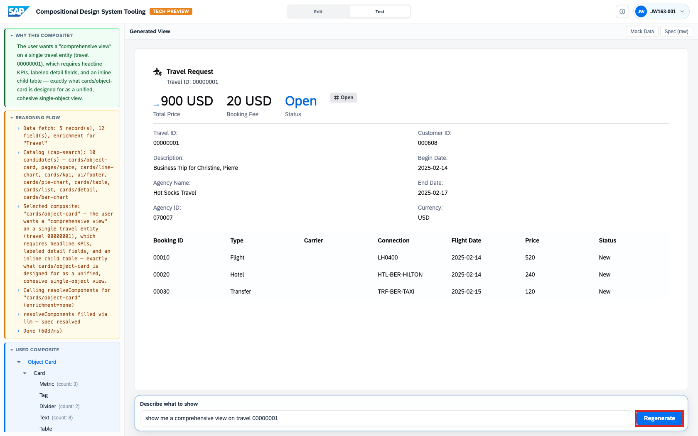

# Exercise 3.2 – Author and Generate

Now make the system work. You'll generate a finished, data-bound view from a
plain-language prompt, decide it could be better, author a brand-new composite
from a description, and then see the system select your new composite the next
time the same request comes in.

> **Prerequisite:** [Exercise 3.1 – Understand the Concepts](../3.1-concepts/README.md).
> **Tool:** <https://compositional-ui-tooling.cfapps.eu10-005.hana.ondemand.com/>

Steps:

- [3.2.1 Generate your first view](#321-generate-your-first-view)
- [3.2.2 Author a new composite from a description](#322-author-a-new-composite-from-a-description)
- [3.2.3 Close the loop: your new composite is selected](#323-close-the-loop-your-new-composite-is-selected)

## 3.2.1 Generate your first view

Click the **SAP logo** (top-left) to go to the **Generate a view** prompt.

In the prompt box, type:

```
show me a comprehensive view on travel 00000001
```

Click **Generate**. After a few seconds the tool switches to the **Test** workspace and shows the result.

### Read the generated view

Read three areas of the Test workspace, matching the screenshot below.

- **The result (center).** Inspect the **Travel Request** card. It shows the
  record's identifier (`Travel ID: 00000001`), a status **Tag** (**Open**),
  and a flat grid of label/value pairs: Travel ID, Begin Date, Description,
  End Date, Agency Name, Booking Fee, Agency ID, Total Price, Customer ID,
  Currency. Your run's values may differ from this example.
- **Why this composite? (top-left, green panel).** Read the justification.
  The request names a single specific record (`travel 00000001`), which
  matches `cards/detail`: a composite whose purpose is to show all
  attributes of a single record in a stacked label/value layout.
- **Reasoning flow (left, yellow panel).** Follow the trace from the data
  fetch to **Done**. It shows what was retrieved, which candidates were
  considered, and why `cards/detail` was selected.



Check these entries in the trace:

- **Data fetch**: 5 records and 12 fields, with enrichment for **Travel**. These
  are the five mock Travel records that ship with the workshop dataset, not a
  filtered subset for travel `00000001`: the detail card picks the matching
  record from them.
- **Catalog (cap-search)**: 9 candidates, including `cards/detail`, `cards/kpi`,
  `cards/bar-chart`, `cards/list`, and `cards/table` in this captured run.
- **Selected composite**: `cards/detail`, followed by its selection reason.
- **resolveComponents** and **spec resolved**: the component resolution and
  spec-generation stages.
- **Done**: the recorded duration, about 5 seconds in this example.

This trace is a feature of the tool, aimed above all at the people who design composites. The output
is accompanied by the data that was retrieved, every composite that was considered, the one that was
selected, and the reason for the selection. A composite designer uses it to see why the system chose
(or passed over) their composite and to refine its rules and signals accordingly. It doubles as a
provenance record: for anyone asking "where did this come from?", the trace provides the answer.

**Optional:** scroll below the trace and expand **Used composite** (left,
blue panel) to inspect the composition hierarchy. For this run it is
`Detail Card` → `Card` → `Tag` + `Text` (count: 10), one Text primitive per
label/value pair.

### Step back and judge the result

The system picked a reasonable composite for the request. The record is
identified, the status is called out, and every field is on screen. For a
"comprehensive view", though, the result is thin:

- The important numbers (**Booking Fee**, **Total Price**) are mixed in with
  descriptive fields instead of being highlighted at the top.
- Related records are missing. A travel request has bookings underneath it, and
  none of them are shown here.
- Everything shares one layout: a flat two-column grid of labels and values.

That is the hook for the next step. The catalog does not yet contain a
composite that structures a single business object the way we would like. So
we will author one.

## 3.2.2 Author a new composite from a description

So far you have only *generated from* the catalog. This step shows the other half of the tool: the
catalog is **extensible**. A new composite can be authored from a plain-language description, and
the system drafts its structure *and* its rules. We will author a composite that fixes the gaps we
just noticed: headline KPIs at the top, a details section in the middle, and a child-records table
at the bottom.

### Open and name the composite

The wizard runs in three stages, labeled **1 Location**, **2 Name**, and
**3 Describe** at the top of the dialog.

- **Start authoring.** Switch to **Edit → Composites** and click
  **`+ Add Composite`** at the bottom of the Composites list. The wizard
  opens on stage **1 Location**.
- **Location.** Enter `cards` in the field (its placeholder reads
  `e.g. cards`) and click **Next**. Location is just a folder for organizing
  the catalog; it has no special meaning today and does not affect how the
  composite is selected or generated.


- **Name.** On the next screen, enter `Object Card` and click **Next**
  again. The Name screen is not pictured.



### Describe and generate

The dialog is now on stage **3 Describe**. Paste this brief into the
**Describe this composite** text area (the field holds grey placeholder
text until you type):

```
An object card that gives a comprehensive view of a single business object. At the top,
show 2-3 KPI metrics side by side: the most important numeric values and the overall status.
Below that, a details section with the key descriptive fields of the object - things like
reference numbers, names, dates, and a description. At the bottom, a table showing the child
records from the main 1:n association of the object - for example the line items of an order,
or the bookings of a travel request.
```

Notice the brief says nothing about travel. It describes a *shape*: a KPI
row, a details section, and a child table for a 1:n association. That lets
the same composite serve sales orders, projects, purchase orders, and the
travel request we started with.

Click **Generate & open** (bottom-right of the dialog). This calls the
authoring LLM; the help text notes **1–3 minutes**. The button next to it,
**Skip**, creates an empty stub rather than generating rules and a spec.



### Inspect the authored composite

The tool switches back to **Edit → Composites** with your new composite
selected. Read three areas, matching the screenshot below.

- **Composites list (left).** Your new entry appears as **Object Card**
  (`cards/object-card`) with a short description derived from the brief,
  highlighted as the current selection.
- **Rules Definition (center).** Confirm the **Private (only you)** badge
  next to the composite name. This is your own workspace layer, separate
  from the **SAP standard** composites in Exercise 3. Then read **Purpose**,
  **When**, **Never**, and **Must**. In this example the rules are precise
  and operational:
    - **Purpose** names the three sections (KPIs, details, child table) and
      binds the composite to records with a primary 1:n association.
    - **When** lists concrete example objects, "sales order, travel request,
      purchase order, project", and the two signals that must both apply:
      headline KPIs *and* a related child collection.
    - **Never** sends flat peer collections to `cards/table` or `cards/list`,
      single records without a child association to `cards/detail` or
      `cards/kpi`, and purely numeric dashboards elsewhere.
    - **Must** fixes the spec contract: a single-row `Data` array,
      scalar fields bound to `/data/0/fieldName`, and the child table bound
      to `/data/0/{navProperty}`.
- **Preview (right).** The right pane renders the composite against a single
  sample travel record (the header reads **using 1 record**), so you see its
  *shape* made concrete: a KPI row (**1,284.5 USD Total Price**, **45 USD
  Booking Fee**, **Accepted Status**), an **Accepted** tag, a details grid
  of descriptive fields (Travel ID, Departure Date, Agency, Return Date,
  Agency ID, Purpose, Customer ID), and a **Bookings** child table
  (Booking ID, Booking Date, Connection). This is a standalone preview of
  the authored composite; in the next step you run the full generation flow
  and watch the system *select* this composite for your prompt.


## 3.2.3 Close the loop: your new composite is selected

Switch to the **Test** tab in the top switch (next to **Edit**) to return to
the **Generate a view** prompt, and re-run the same request you started with:

```
show me a comprehensive view on travel 00000001
```

Click **Regenerate** and read the result against the screenshot below.

- **Why this composite? (top-left, green panel).** The reason now connects
  the request to `cards/object-card`: a comprehensive single-object view
  with headline KPIs, descriptive attributes, and a related child
  collection, "exactly the use case for cards/object-card". The reason
  comes straight from the rules the authoring step just generated.
- **Reasoning flow (left, yellow panel).** Locate `cards/object-card` in
  both **Catalog (cap-search)** and **Selected composite**. The catalog
  now lists **10 candidates** instead of the 9 you saw in 3.2.1: your new
  composite is in the pool and won the match.
- **Rendered view (center).** The same travel record is now presented in
  three stacked sections: a KPI row (**900 USD Total Price**, **20 USD
  Booking Fee**, **Open Travel Status**), a details grid of descriptive
  fields, and a **Booking ID / Type / Carrier / Booking Date / Price /
  Currency / Status** table of the child bookings. Compare this with the
  flat detail card from 3.2.1: same data in, a very different presentation
  out, because a better composite was available.



This closes the selection loop. The composite you authored in 3.2.2 is now a
first-class member of the catalog: it has rules the matcher can read, a spec
the renderer can bind, and it won the next request without any further input
from you. **Authoring and generation use the same catalog.**

## Summary

- A plain-language prompt yields a finished, **data-bound** view, with a full **Reasoning flow** explaining the choice.
- When the catalog's best match is still thin, you can **author a new composite from a description**, rules and all.
- The authored composite is generic by design: the same **Object Card** serves travel requests, sales orders, and any other single business object with a 1:n child collection.
- That new composite is immediately **selectable** by the generation flow, as the re-run of the opening prompt demonstrates.

Continue to - **[Exercise 3.3 – Explore on Your Own](../3.3-explore/README.md)** for open-ended prompts and challenges.
