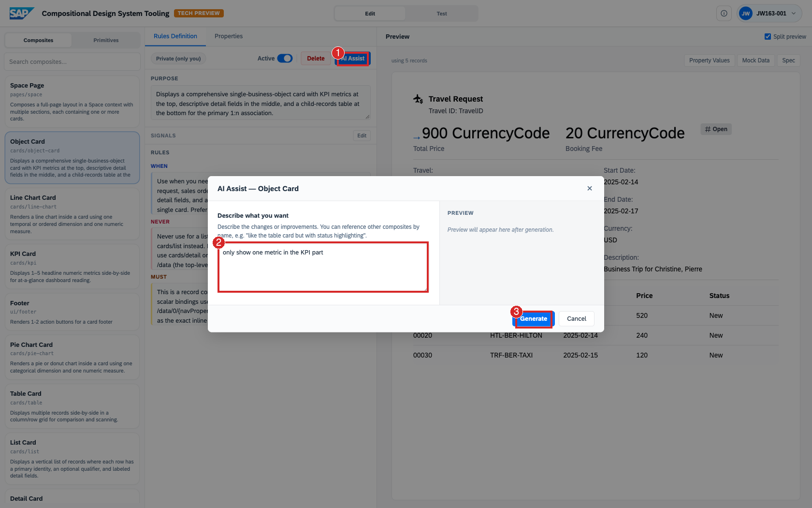

# Exercise 3.3 – Explore on Your Own

From here, you drive. These are open-ended prompts and short challenges to
build your understanding of how a request and the rules interact. Most run from
the **Generate a view** prompt (SAP logo → type → Generate) against the SFlight
data.

As you watch each **Reasoning flow**, keep in mind that each step resolves
deterministically from what is already known, and brings in an LLM only where
genuine judgment is needed, for example when it is unclear which composite
fits a free-form request best.

> **Prerequisite:** [Exercise 3.2 – Author and Generate](../3.2-author/README.md).
> **Tool:** <https://compositional-ui-tooling.cfapps.eu10-005.hana.ondemand.com/>

Steps:

- [3.3.1 Phrasing and composite selection — change the request, observe the result](#331-phrasing-and-composite-selection--change-the-request-observe-the-result)
- [3.3.2 Interpreting the reasoning](#332-interpreting-the-reasoning)
- [3.3.3 Tracing behavior back to a rule](#333-tracing-behavior-back-to-a-rule)
- [3.3.4 Change a rule with AI Assist and observe the effect](#334-change-a-rule-with-ai-assist-and-observe-the-effect)

## 3.3.1 Phrasing and composite selection — change the request, observe the result

Run these in sequence and read the **Reasoning flow** each time to see which composite was selected and why:

| Prompt | Expected result |
| --- | --- |
| `Show me total revenue across all travels` | A single headline number → a `Metric` / KPI, not a table. |
| `Compare total price by agency` | A categorical breakdown → a **bar chart** composite. |
| `Show the trend of bookings over time` | A temporal series → a **line chart** composite. |
| `List every booking with its status` | A scannable list or table. |
| `Give me a full overview of travel bookings` | A richer, multi-section composite (e.g. a page or combined card). |

**Challenge:** phrase a request two different ways that produce the **same** composite; then two *similar* requests that produce **different** composites. Identify the wording that changed the outcome.

## 3.3.2 Interpreting the reasoning

Select any generated view and, using only the left-hand panels, answer:

1. How many **records** were fetched, and how many **fields**?
2. How many composites were **considered** versus **selected**?
3. What was the **one-sentence reason** for the selection — and is it sound?
4. In the **Used composite** tree, which **primitives** did the selected composite render?

This exercise builds the ability to explain a generated UI to a colleague using only the information the panel provides.

## 3.3.3 Tracing behavior back to a rule

Go to **Edit → Composites** and open the composite selected for one of your prompts (e.g. **Table Card** or **Bar Chart Card**). Read its **When / Never / Must** rules.

**Challenge:** identify the exact rule sentence that explains why the prompt resolved to *that* composite rather than a neighboring one (e.g. the KPI card's *"Prefer KPI over table when there are very few metrics (≤5)"*). This connects observed behavior to the authored design knowledge.

## 3.3.4 Change a rule with AI Assist and observe the effect

This exercise shows that **design knowledge is live**: changing a composite's rules changes both how it renders and how the system reasons about it. Use a **Private (only you)** (user-authored) composite, for example the **Object Card** you authored in Exercise 3.2, so the SAP-standard composites are left untouched.

You do not need to generate a view to see the effect. Each composite carries
its own **Preview**, bound to sample data, and AI Assist shows the revised
preview right in the dialog. That is enough to judge the change.

Rather than hand-editing the rule text, let the tool revise the composite for
you. **AI Assist** takes a plain-language instruction and rewrites the rules
to match, the same authoring model you used in Exercise 3.2, now
pointed at an existing composite.

1. **Open AI Assist.** Open your composite in **Edit → Composites**, confirm
   the **Private (only you)** badge, and note its current **Preview** on the
   right. Click **AI Assist** in the **Rules Definition** toolbar.
2. **Describe the change.** In the **Describe what you want** box, type one
   short instruction. For example:

   ```
   only show one metric in the KPI part
   ```

   or

   ```
   don't use semantic coloring
   ```

3. **Generate.** Click **Generate**. The assistant rewrites the composite's
   rules to match your instruction, and the **Preview** pane in the
   dialog shows the revised composite once generation completes. Compare it
   with the preview you noted in step 1, and click **Apply** to accept the
   change when you are happy with it.



Taken with Exercise 3.2 and 3.3.3, this is the composite designer's inner loop: author a
composite, observe which requests it is chosen for and why, sharpen its
**When / Never / Must** rules, and regenerate. The thinking is captured on the
building block once and reused on every matching request.

## Three points to retain

1. **The Catalog is the guardrail.** The system composes only **approved primitives and composites** — it cannot produce off-brand UI.
2. **Design knowledge drives the selection.** The **When / Never / Must** rules shipped with each component are what turn a general request into the appropriate layout — and they are authored, inspectable, and editable.
3. **Separation of *what* from *how*, with a trace.** The user supplies intent and data (**what**); the system selects the composite and renders the spec (**how**) — and the **Reasoning flow** documents the decision.

> One spec, rendered to many surfaces, selected by rules, and documented by a trace — this is the Compositional Design System.

## You've reached the end

This is the last exercise. Across the session you built a custom SAP Fiori app
with AI tooling, saw how an agent uses an OData service to surface business
data, and watched the SAP Compositional Design System assemble enterprise UI
from your data at runtime in Joule Work.

## Where to go next

- **Keep experimenting with the tool** with your own prompts and composites:
  <https://compositional-ui-tooling.cfapps.eu10-005.hana.ondemand.com/>
- **Go further with SAP Fiori elements and AI** in the companion TechEd session
  **JW262 - OData to outcomes: Build AI-enabled SAP Fiori apps using SAP Fiori
  elements**.
- **Learn more about SAP Joule Studio:**
  <https://www.sap.com/products/artificial-intelligence/joule-studio.html>
- **Revisit any part** of the session from the
  [exercises overview](../../README.md).

## Thank you

Thanks for working through the session. Feedback and questions are welcome via
the repository's **Issues** tab.

